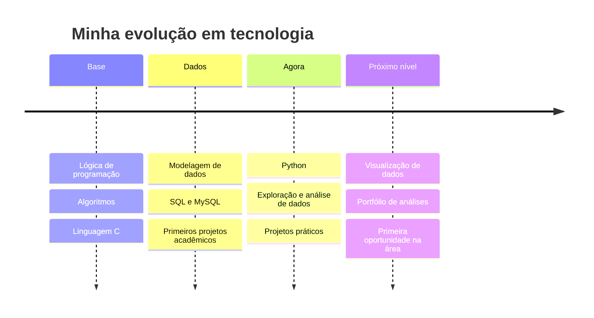

<!-- ===================================================== -->
<!--            HENRIQUE GONÇALVES · PERFIL v2.0           -->
<!-- ===================================================== -->

<div align="center">


<br/><br/>


<br/>

<a href="https://github.com/henriquegoncalves29">
  
</a>


</div>

<br/>


<div align="center">

## `01` &nbsp;/&nbsp; QUEM ESTÁ POR TRÁS DOS DADOS

### *Não basta ter informação. É preciso saber interpretá-la.*

</div>

Sou estudante de **Ciência da Computação** e estou direcionando minha trajetória para a área de **Análise de Dados**.

Me fascina entender **como os sistemas funcionam**, **como os dados se conectam** e **como a lógica pode resolver problemas reais**. Hoje, meu foco está em fortalecer os fundamentos: programação, algoritmos e modelagem de dados.

> 💡 *Não estou apenas aprendendo ferramentas. Estou construindo uma forma de pensar.*

<div align="center">


</div>

---

<div align="center">

## `02` &nbsp;/&nbsp; MEU ARSENAL DIGITAL

### *As ferramentas que fazem parte da minha jornada.*

</div>

<table align="center">
<tr>
<td align="center" width="33%">

**⌨️ PROGRAMAÇÃO**


<sub>Lógica, algoritmos<br/>e resolução de problemas</sub>

</td>
<td align="center" width="33%">

**🗄️ DADOS**


<sub>Modelagem, consultas<br/>e organização da informação</sub>

</td>
<td align="center" width="33%">

**🛠️ DESENVOLVIMENTO**


<sub>Versionamento, colaboração<br/>e produtividade</sub>

</td>
</tr>
</table>

<p align="center">
  <sub>📚 Estudando, praticando e evoluindo todos os dias.</sub>
</p>

---

<div align="center">

## `03` &nbsp;/&nbsp; MISSÃO ATUAL

### *O que estou construindo agora?*

</div>

| 🎯 FRENTE | 📌 O QUE ESTOU TRABALHANDO | ⚡ NÍVEL DE FOCO |
|:---|:---|:---|
| **Programação** | Lógica, algoritmos e linguagem C | `██████████░` &nbsp;alto |
| **Banco de Dados** | Modelagem de dados e SQL | `█████████░░` &nbsp;alto |
| **Análise de Dados** | Interpretação e exploração de dados | `███████░░░░` &nbsp;crescendo |
| **Desenvolvimento** | Projetos práticos e evolução técnica | `████████░░░` &nbsp;constante |

<div align="center">

<br/>


</div>

---

<div align="center">

## `04` &nbsp;/&nbsp; PROJETOS EM DESTAQUE

### *Ideias transformadas em código.*

<sub>Cada projeto é uma etapa da minha evolução.</sub>

</div>

<br/>

<table align="center">
<tr>
<td width="50%" valign="top">

### 🌱 Viva Hoje
`WEB` &nbsp; `DESENVOLVIMENTO`

Projeto de desenvolvimento web.

**[▶ Ver repositório](https://github.com/henriquegoncalves29/viva-hoje)**

</td>
<td width="50%" valign="top">

### 🗺️ Modelagem Hiroshima
`DADOS` &nbsp; `ACADÊMICO`

Projeto acadêmico de modelagem de dados.

**[▶ Ver repositório](https://github.com/henriquegoncalves29/Modelagem_Hiroshima)**

</td>
</tr>
<tr>
<td width="50%" valign="top">

### 💈 Barbearia Na Boa
`WEB` &nbsp; `DESENVOLVIMENTO`

Projeto de desenvolvimento web.

**[▶ Ver repositório](https://github.com/henriquegoncalves29/barbearia_naboa)**

</td>
<td width="50%" valign="top">

### 🔒 Próximo Projeto
`EM BREVE`

Novas ideias, novos desafios e novos aprendizados.

*Carregando... `▓▓▓░░░░░░░`*

</td>
</tr>
</table>

---

<div align="center">

## `05` &nbsp;/&nbsp; ROADMAP DA JORNADA

### *Para onde estou indo.*

</div>



<details>
<summary><b>🧭 Clique para ver meus princípios de trabalho</b></summary>

<br/>

- **Entender antes de decorar.** Quero saber o porquê das coisas funcionarem.
- **Dados contam histórias.** Meu papel é aprender a ouvi-las.
- **Pequenos commits, grandes resultados.** Constância vence intensidade.
- **Errar faz parte.** Cada bug é uma aula gratuita.
- **Compartilhar acelera.** Aprender em público é o caminho mais rápido.

</details>

---

<div align="center">

## `06` &nbsp;/&nbsp; ANALYTICS DO GITHUB

### *Dados sobre a minha própria jornada.*

<sub>O código também conta histórias.</sub>

<br/>


<br/><br/>


<br/><br/>


<br/><br/>


</div>

---

<div align="center">

## `07` &nbsp;/&nbsp; VAMOS CONECTAR?

### *Bora trocar ideia sobre dados, código e tecnologia.*

<br/>

<a href="https://github.com/henriquegoncalves29">
  
</a>

<!-- Descomente e preencha para adicionar mais contatos:
<a href="https://www.linkedin.com/in/SEU-USUARIO">
  
</a>
<a href="mailto:seu@email.com">
  
</a>
-->

</div>

---

<div align="center">

## `08` &nbsp;/&nbsp; A PRÓXIMA VERSÃO

### *O conhecimento nunca termina.*

**PENSE. ANALISE. CONSTRUA. EVOLUA.**

<br/>

```text
01001000 01000101 01001110 01010010 01001001 01010001 01010101 01000101
```

<sub>HENRIQUE GONÇALVES · CIÊNCIA DA COMPUTAÇÃO · 2026</sub>

<br/>


</div>
